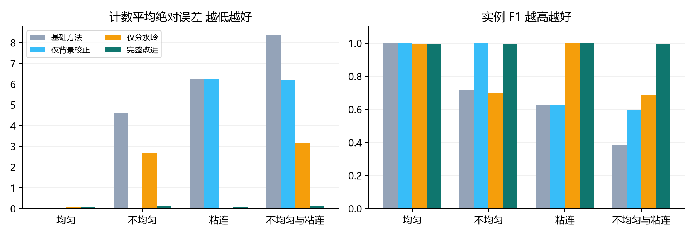
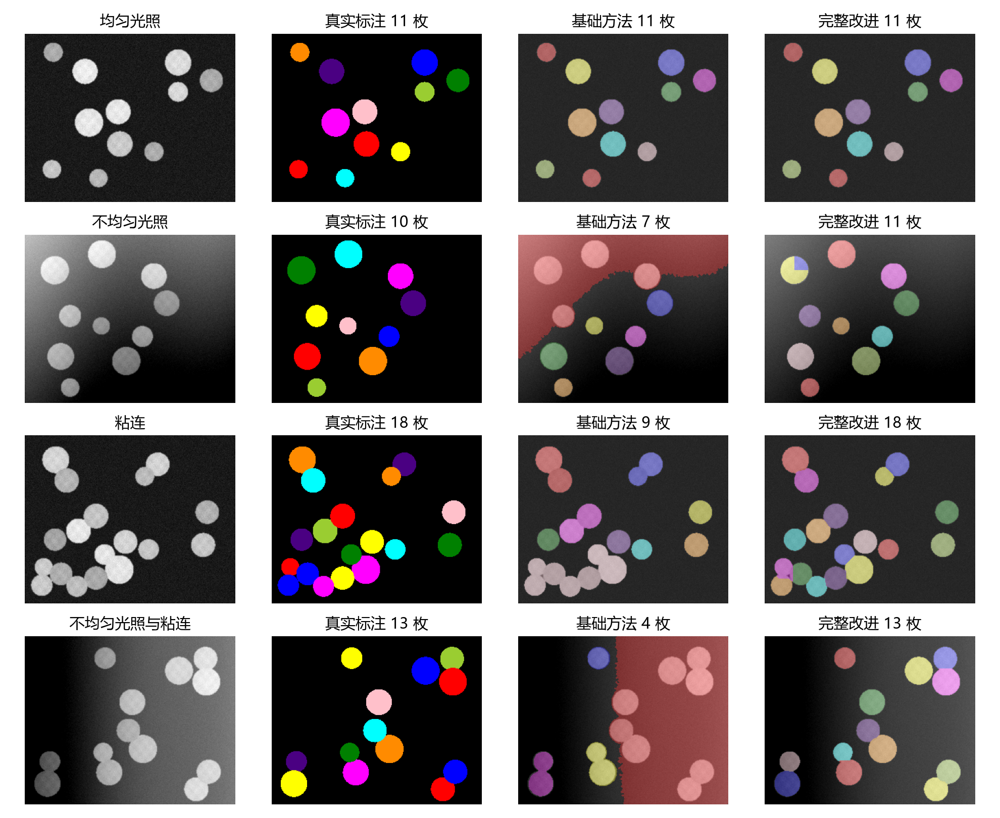
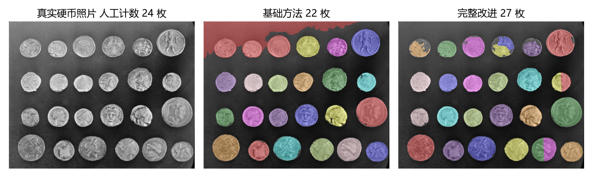

# 不均匀光照下的硬币图像分割与计数

以 Otsu + 连通域计数为基础，加入形态学背景校正与距离变换分水岭，分析各模块在光照变化和目标粘连条件下的作用。无需 GPU 或训练模型。

工程链接：**https://github.com/KVingler/coin-segmentation-coursework**

完整实验报告：[实验报告.docx](实验报告.docx)

## 任务和方法

输入亮硬币、暗背景的灰度图像，输出前景掩膜、逐个硬币的实例标签与计数。

| 方法 | 背景校正 | 分水岭 | 作用 |
|---|---|---|---|
| baseline | 否 | 否 | 高斯滤波、全局 Otsu、形态学处理、连通域 |
| background_only | 是 | 否 | 隔离背景校正的作用 |
| watershed_only | 否 | 是 | 隔离粘连分离的作用 |
| improved | 是 | 是 | 完整改进 |

原理参考 scikit-image 官方[硬币分割教程](https://scikit-image.org/docs/stable/auto_examples/applications/plot_coins_segmentation.html)和[分水岭示例](https://scikit-image.org/docs/stable/auto_examples/segmentation/plot_watershed.html)。本项目自行实现基线和改进模块，未声称修改或 fork 上游工程。具体变化见 [代码修改说明](CODE_CHANGES.md)。

## 安装与运行

推荐 Python 3.12（实际验证版本见 `results/experiment.json`）。在工程目录运行：

```powershell
python -m venv .venv
.\.venv\Scripts\Activate.ps1
python -m pip install -r requirements.txt
python run_experiment.py
python -m unittest discover -s tests -v
python predict.py data/real/coins.png --output results/prediction
```

若 PowerShell 不允许执行激活脚本，可跳过激活，直接用 `.\.venv\Scripts\python.exe` 替换上述 `python`。Linux/macOS 的激活命令是 `source .venv/bin/activate`。

`run_experiment.py` 重新生成数据、验证集搜索参数、评估 80 张测试图像和真实照片，并输出 CSV、JSON 与图表。已附全部数据和一次完整实测结果，可先直接查看报告，无需重新运行。脚本会覆盖 `data/synthetic` 中同名数据及对应实验结果；不删除其他文件。修改配置后，如需同步 Word 报告，再运行：

```powershell
python tools/build_report.py
```

单图预测支持手动参数覆盖，例如 `python predict.py my_photo.png --background-size 81 --h 2`。这类手动结果不属于报告中固定参数的测试成绩；图像尺寸和硬币半径变化时应重新在独立验证集上选参。

## 数据

- 100 张自生成圆盘图像，256×320；20 张验证、80 张测试，各有均匀光照、不均匀光照、粘连、光照与粘连同时存在四类。
- 真值为生成器产生的可见实例掩膜；每图 10–18 枚。验证和测试使用不同随机场景和种子。
- 一张 `skimage.data.coins()` 公开真实照片，303×384，人工计数 24 枚。没有人工像素掩膜，不计算真实图的 IoU/F1/PQ。
- 完整来源、许可、标签格式和退化参数见 [data/README.md](data/README.md)、[THIRD_PARTY_NOTICES.md](THIRD_PARTY_NOTICES.md)。

## 结果

验证集从 12 组参数中选择开运算宽度 81、h-maxima 峰高 1.0。以下为 80 张合成测试图像的逐图宏平均，实例匹配要求 IoU 严格大于 0.5。

| 方法 | 计数 MAE ↓ | 数量完全正确率 ↑ | 前景 IoU ↑ | 实例 F1 ↑ | PQ ↑ |
|---|---:|---:|---:|---:|---:|
| 基础方法 | 4.8000 | 25.00% | 0.6893 | 0.6808 | 0.6059 |
| 仅背景校正 | 3.1125 | 50.00% | 0.9865 | 0.8053 | 0.7343 |
| 仅分水岭 | 1.4750 | 55.00% | 0.6892 | 0.8456 | 0.7983 |
| 完整改进 | 0.0750 | 92.50% | 0.9865 | 0.9973 | 0.9674 |





**适用范围和反例**：合成数据较理想，不能把上述成绩等同于真实照片精度。均匀且不粘连组中基础方法 20/20 张计数正确，完整方法 19/20 张。真实照片基础方法计数 22、仅背景校正 24、仅分水岭 27、完整改进 27，人工参考为 24；完整方法出现了过分割。报告保留最差合成样例和真实场景的负面结果，不根据测试图或真实照片再调参。



## 文件结构

```text
coinlab/baseline.py       基础算法
coinlab/improved.py       背景校正和分水岭
coinlab/dataset.py        数据生成与读取
coinlab/metrics.py        一对一实例匹配和评价
run_experiment.py         完整实验入口
predict.py                自定义图像预测
config.json               数据与参数搜索配置
tests/test_core.py        6 项核心校验
tools/build_report.py     从实测 JSON 构建 Word 报告
data/                     原图、真值、清单与数据说明
results/                  逐图指标、汇总、参数搜索、图表
```

`results/per_image.csv` 是 80×4=320 行逐图记录；`summary.csv` 按条件汇总；`validation_search.csv` 保留全部选参记录；`experiment.json` 记录环境、耗时和最差样例。计时仅包含分割、单次测量，受硬件和负载影响，重新运行不会逐位一致。数值指标与数据 PNG 可在相同依赖和配置下确定性复现。
