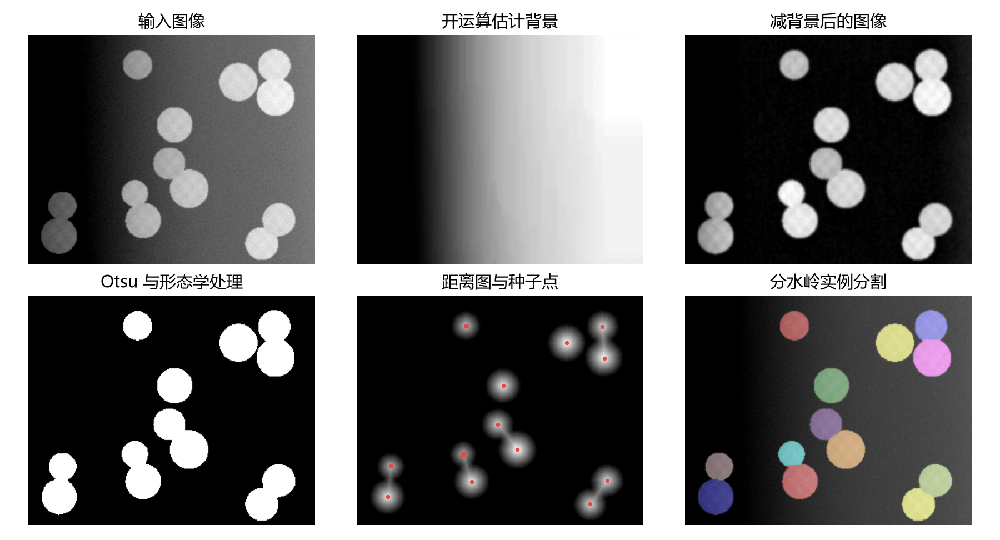
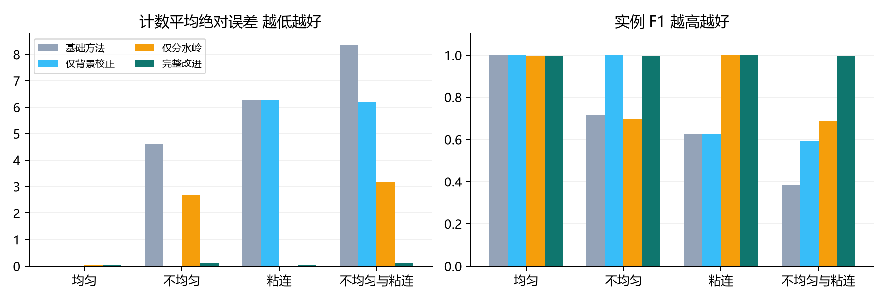
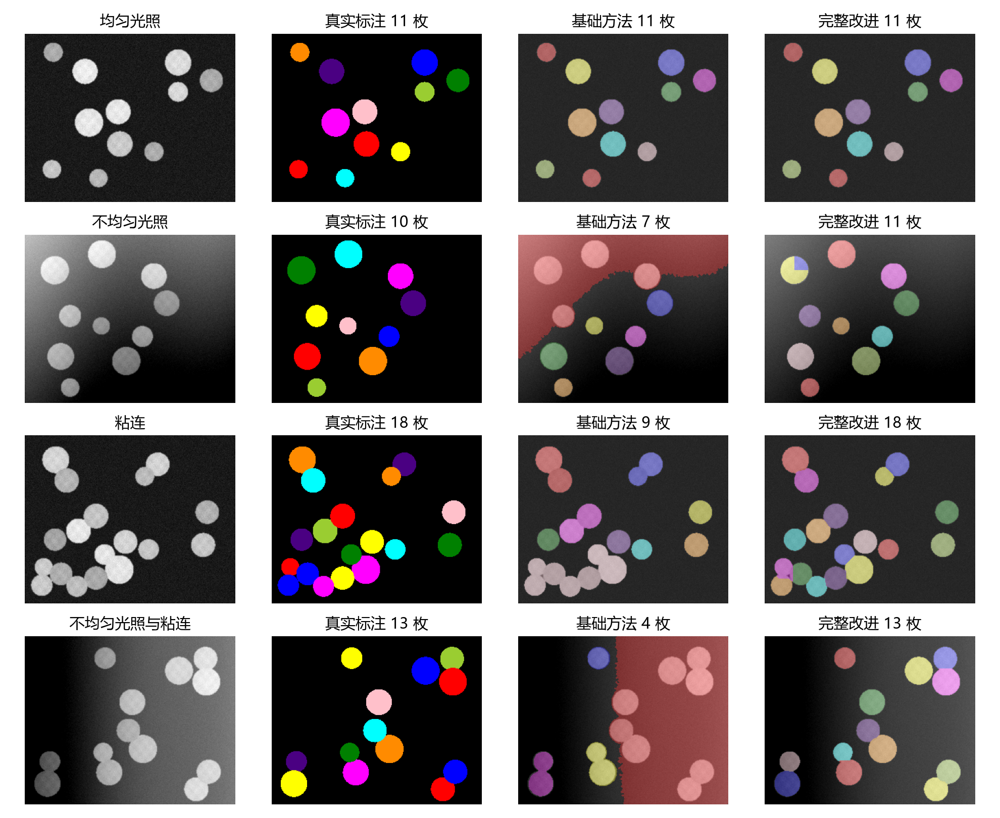
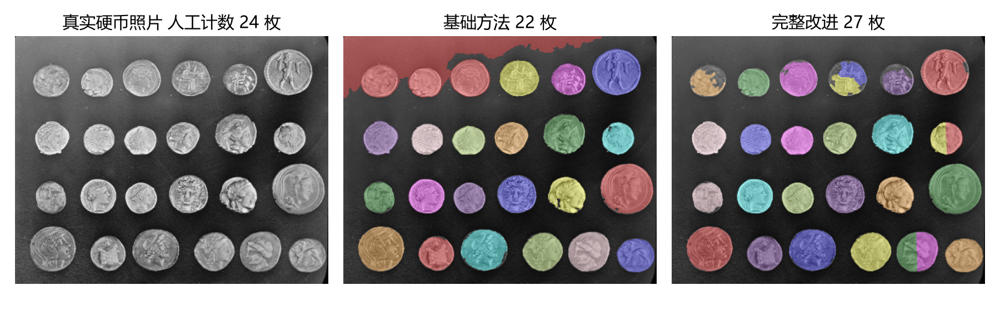
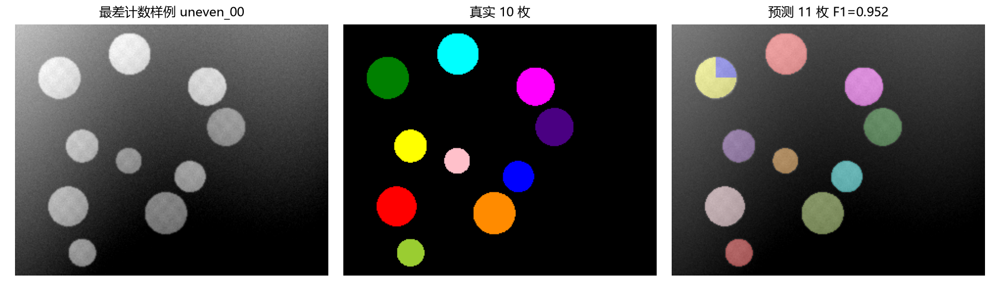

不均匀光照下的
硬币图像分割与计数

图像处理与分析课程实验报告

姓名 __________    学号 __________    班级 __________
完成日期  2026 年 11 月 7 日

## 1 工程链接与任务描述

GitHub 工程 https://github.com/KVingler/coin-segmentation-coursework

本实验完成一套传统图像处理流程：输入亮硬币与暗背景的灰度图像，自动分离硬币、给出实例标签并统计数量。重点研究不均匀光照造成的前景误检，以及相邻硬币粘连造成的漏计数。输出包括彩色实例叠加图、计数、逐图评价数据和结果对比图。

实测表明，在 80 张受控合成测试图像上，背景校正与标记控制分水岭联合使用，将计数平均绝对误差从 4.800 枚降至 0.075 枚，数量完全正确率从 25% 提升至 92.5%。真实照片存在过分割，说明该改进的有效性依赖目标形状、尺寸和表面纹理，不能直接把合成结果作为真实场景精度。

### 1.1 课程知识与适度拓展

基础部分使用高斯滤波、Otsu 阈值分割、形态学开运算、孔洞填充和连通域标记，均属于图像处理课程常见内容。拓展部分加入大尺度灰度开运算估计背景、欧氏距离变换、h-maxima 种子抑制和标记控制分水岭，并通过独立验证集选参及模块消融检验改进原因。项目不使用深度学习和预训练模型，普通 CPU 即可运行。

### 1.2 工程与报告对应关系

| 课程要求 | 工程中的对应材料 |
|---|---|
| 工程链接与源代码 | 本页 GitHub 链接及 coinlab 与实验入口 |
| 任务与数据描述 | 第 1 节任务 第 2 节数据及标签格式 |
| 代码修改描述 | 第 4 节改动映射及 CODE_CHANGES.md |
| 结果对比 | 第 5 至 7 节定量 消融 定性及失败分析 |

## 2 数据描述与实验设计

定量实验使用自行生成的圆盘图像模拟硬币。选择合成数据的原因是可以直接获得每枚硬币的精确可见区域，单独控制光照和粘连；它不包含真实币面的复杂浮雕、反光和遮挡，因此结果只反映受控条件下的算法表现。另使用一张公开真实照片观察方法迁移后的行为。

| 数据项 | 具体设置 |
|---|---|
| 合成图像 | 100 张 256×320 灰度图 uint8 |
| 数据划分 | 验证集 20 张 测试集 80 张 不设训练集 |
| 四种条件 | 均匀光照 不均匀光照 粘连 光照与粘连 |
| 每条件样本 | 验证 5 张 测试 20 张 |
| 目标数量与尺寸 | 每图 10 至 18 枚 半径 13 至 22 像素 |
| 像素标签 | NPZ 中 labels 为 uint16 0 背景 正整数为实例 |
| 真实照片 | coins.png 303×384 人工计数 24 枚 无像素标注 |

### 2.1 图像生成与真实标注

背景初值为 55，硬币基础灰度随机取 135 至 180，叠加低幅纹理和中心亮度变化。图像经过 sigma=0.65 的高斯模糊，再加入标准差 4 的高斯噪声，并裁剪到 0 至 255。不均匀光照组增加随机方向斜坡，幅度系数为 110 至 165，再叠加幅度 18 的正弦变化。部分像素因裁剪发生饱和，这也是实验退化的一部分。

非粘连组要求圆心距离大于半径和的 1.12 倍。粘连组每三个目标尝试生成一对邻近目标，期望圆心距为半径和的 0.82 至 0.95 倍，所有目标的最小距离限制为半径和的 0.80 倍；因此包含轻度几何重叠。后绘制的圆盘遮住先绘制圆盘，真值标注只保留各目标的可见区域，不把被遮挡部分当作可见像素。

### 2.2 划分与复现控制

总随机种子为 20261107；按条件增加 1000，测试集种子额外增加 100000。验证集与测试集独立生成场景，没有把同一场景的不同光照版本分到两个集合。manifest.json 记录每张图的种子、条件、路径、数量和 PNG 的 SHA256；分割函数只接收图像与算法参数，不接收真实数量或标签。

### 2.3 公开真实图像

真实照片来自 skimage.data.coins，原始来源为 Brooklyn Museum Collection，官方说明为无已知版权限制 [1]。人工按四行、每行六枚得到参考计数 24，记录于 data/real/reference.json。该图没有本项目人工描绘的实例掩膜，因此仅进行计数和可视化检验，不报告真实图的像素 IoU、实例 F1 或 PQ。

## 3 算法原理与处理流程

### 3.1 基础方法

首先用 sigma=1 的高斯滤波抑制噪声，再用 Otsu 法选择使类间方差最大的阈值，得到亮前景。所有方法统一进行一次十字结构元素二值开运算、孔洞填充，并删除面积小于 120 像素的连通域。基础方法直接把每个连通域作为一枚硬币：当背景灰度与硬币重叠时会误分前景，当多个硬币相连时会把它们合成一枚。

### 3.2 背景校正与粘连分离

用宽度 k 的方形灰度开运算去掉局部亮目标，得到缓慢变化的背景估计 B，再从平滑图像 I 中减去 B。该过程相当于白顶帽变换，使不同位置的背景趋近于零，便于继续使用全局 Otsu。结构元素应大于目标直径；如果硬币过大或密集成片，背景估计也可能失真。

B = opening(I, k)    J = I − B

对二值前景 M 计算欧氏距离图 D，每个像素值是它到最近背景像素的距离。近圆形硬币的中心通常形成峰值。在 D 上取峰高至少为 h 的 h-maxima 区域作为种子，用负距离图作为地形，在 M 内进行标记控制分水岭 [2][3]。它可把同一连通域中的多个近圆目标分开。h 越大，浅峰越容易被抑制，也越可能合并真实目标。

D(p) = min distance(p, q)    q in background

若某个小连通域没有足够显著的峰，则在其最大距离点补一个种子；分水岭后再次过滤极小实例并连续化标签。该补种子机制保证小连通域不被静默丢弃，但不能保证每枚真实硬币只有一个种子。

图 1 不均匀光照与粘连样例的改进流程 红点为种子像素



## 4 代码修改与参数选择

本工程自行编写基础算法，概念起点是 scikit-image 的硬币分割教程 [4]。这里的代码修改指从 coinlab/baseline.py 到 coinlab/improved.py 的流程变化，并非宣称修改了上游库或其仓库。底层滤波、分水岭等使用成熟库接口，实现工作集中在模块组织、种子处理、实验设计与评价。

| 代码位置 | 具体修改 | 预期影响 |
|---|---|---|
| improved.segment | 增加灰度开运算与背景相减 | 降低不均匀光照误分 |
| improved.segment | 增加距离图与 h-maxima 种子 | 给每个近圆目标提供中心 |
| improved.segment | 连通域计数改为分水岭实例 | 分开相邻粘连目标 |
| improved.segment | 缺种子补点 面积过滤 重编号 | 提高特殊区域处理稳定性 |
| run_experiment.py | 验证集网格搜索 四方法消融 | 明确选参 区分模块贡献 |
| metrics.py | 一对一匹配与多指标评价 | 同时反映像素和实例错误 |

### 4.1 保持一致的部分

四种方法使用相同高斯滤波参数、二值开运算、孔洞填充、最小面积与输入图像。消融方法通过 correct_background 和 split_touching 两个开关关闭模块，沿用完整方法的验证参数；本实验衡量同一配置下模块开关的影响，没有为每个消融方法分别调到最优。

### 4.2 验证集搜索结果

搜索 k∈{45,61,81}、h∈{1,2,3,4} 共 12 种组合。选择规则预先固定为计数 MAE 最低，其次实例 F1 最高，仍相同则选更小的 k 和 h。下表为 20 张验证图像的计数 MAE，完整记录含 F1，保存在 validation_search.csv。

| k 像素 | h 为 1 | h 为 2 | h 为 3 | h 为 4 |
|---|---|---|---|---|
| 45 | 0.250 | 0.300 | 0.450 | 0.650 |
| 61 | 0.250 | 0.300 | 0.450 | 0.700 |
| 81 | 0.200 | 0.250 | 0.400 | 0.700 |

最终选择 k=81、h=1.0，验证 MAE 为 0.200 枚、实例 F1 为 0.9885。之后固定参数评估测试集和真实照片。h 增大时 MAE 总体上升，说明此处较浅的真实峰也参与区分粘连目标；这并不意味着其他尺寸或噪声水平下也应取 h=1。

参数与真实物体的像素尺度相关，属于本实验的显式先验。输入更大尺寸图像时，应按目标尺寸重新设置结构元素和面积阈值，并用新的独立验证集选择参数。

## 5 评价指标与总体结果对比

### 5.1 指标定义

计数 MAE 是各图像预测数量与真实数量之差的绝对值的平均；数量完全正确率只要求数量相同，不能单独证明对象分割正确。前景 IoU 是全部硬币前景的交集面积除以并集面积，不区分实例。实例匹配要求预测区域与真实区域 IoU 严格大于 0.5，使用一对一分配；由此计算 TP、FP、FN。

F1 = 2TP / (2TP + FP + FN)

PQ = sum matched IoU / (TP + 0.5FP + 0.5FN)

F1 评价是否分对各个实例，PQ 进一步要求实例边界质量。下表所有指标先逐图计算，再对 80 张测试图取宏平均；四种条件样本数相等。实例 F1 高于 PQ 是因为部分边界仍有像素偏差。

| 方法 | MAE ↓ | 正确率 ↑ | 前景 IoU ↑ | 实例 F1 ↑ | PQ ↑ |
|---|---|---|---|---|---|
| 基础方法 | 4.8000 | 25.00% | 0.6893 | 0.6808 | 0.6059 |
| 仅背景校正 | 3.1125 | 50.00% | 0.9865 | 0.8053 | 0.7343 |
| 仅分水岭 | 1.4750 | 55.00% | 0.6892 | 0.8456 | 0.7983 |
| 完整改进 | 0.0750 | 92.50% | 0.9865 | 0.9973 | 0.9674 |

图 2 四种条件的计数误差和实例 F1 对比



完整方法相对基础方法的计数 MAE 降低 98.44%，80 张中有 74 张数量完全正确。仅背景校正能把前景 IoU 提高到 0.9865，但粘连仍会合并，计数 MAE 仍为 3.1125。仅分水岭能改善实例划分，却不能纠正原先错分的背景。两者联合时才同时改善光照与粘连问题。

前景 IoU 相同不代表实例效果相同。仅背景校正与完整改进几乎保留同一前景并集，但完整方法进一步切分内部实例，实例 F1 因而提高。这说明只用二值分割指标会遗漏计数任务的主要错误。

## 6 分条件结果与图像对比

| 测试条件 | 基础 MAE | 改进 MAE | 基础 F1 | 改进 F1 |
|---|---|---|---|---|
| 均匀光照 | 0.000 | 0.050 | 1.000 | 0.998 |
| 不均匀光照 | 4.600 | 0.100 | 0.716 | 0.996 |
| 粘连 | 6.250 | 0.050 | 0.627 | 0.999 |
| 光照与粘连 | 8.350 | 0.100 | 0.381 | 0.997 |

图 3 各条件固定展示测试集中编号 00 的样例 颜色仅区分实例



均匀光照且不粘连时，基础方法已经足够，20 张均计数正确；完整方法有一张多分，正确率为 95%，所以改进并非所有条件都更优。不均匀光照时，基础方法把亮背景连入前景；粘连时，多枚硬币形成一个连通域。图 3 最后一行中，完整方法既抑制了背景误分，又将相邻圆盘分开。样例按编号固定选取，第二行同时保留完整方法多分一个实例的现象。

## 7 真实场景检验与失败分析

图 4 真实硬币图像的固定参数预测 人工参考为 24 枚



| 人工参考 | 基础方法 | 仅背景校正 | 仅分水岭 | 完整改进 |
|---|---|---|---|---|
| 24 | 22 | 24 | 27 | 27 |

真实照片中，基础方法把左上角部分亮背景并入目标，得到 22 枚；仅背景校正得到 24 枚，计数与人工参考一致。完整方法得到 27 枚，绝对计数误差为 3，反而高于基础方法的 2。观察叠加图可见部分单枚硬币被分为两块，表面浮雕与不规则轮廓在距离图上引出多个种子，h=1 的固定设置无法全部抑制。这里只据可视化解释现象，没有像素真值来量化边界质量。

图 5 完整方法测试集中的最差计数样例 同误差时选 F1 最低者



最差样例为 uneven_00，真实 10 枚、预测 11 枚，实例 F1 为 0.9524。从图中可见某枚圆盘被重复切分。合成图像的光照裁剪和二值轮廓扰动也会产生额外峰值，说明峰高抑制只能缓解过分割，不能从原理上保证一个目标一个种子。

### 7.1 方法局限与可继续改进的方向

合成圆盘与真实硬币在纹理、尺寸、反光和形状上存在差别；一张真实照片只能展示问题，不能估计真实泛化能力。该流程还假设目标比背景亮、尺度接近验证集，不能恢复严重遮挡的硬币。下一步可收集多张手机实拍图并独立标注，在新的验证集上选择自适应峰值参数，或依据分割块之间的形状与边界证据合并过分割区域。这些方向尚未实现，不计入本次成绩。

## 8 源代码运行与实验总结

### 8.1 运行环境和复现步骤

本次环境为 Windows，Python 3.12.14，NumPy 2.3.5、SciPy 1.18.1、scikit-image 0.26.0、Matplotlib 3.11.2。requirements.txt 固定依赖版本。未训练模型，不依赖 GPU，数据和真值已经随工程提供。

```python
python -m pip install -r requirements.txt
python run_experiment.py
python -m unittest discover -s tests -v
python predict.py data/real/coins.png
```

先运行完整实验以生成数据、选择参数和重算指标；单图入口会保存 overlay.png、labels.npz 与 count.json。若更新了实验结果，可运行 python tools/build_report.py 重建报告。6 项核心校验覆盖空图、非连续标签、一对一匹配的合并错误、粘连圆盘分离、生成器确定性和非法参数。

### 8.2 核心代码与结果文件

```python
background = ndi.grey_opening(smooth, size=(k, k))
corrected = smooth - background
mask = clean_mask(corrected > threshold_otsu(corrected))
distance = ndi.distance_transform_edt(mask)
markers, _ = ndi.label(h_maxima(distance, h) & mask)
labels = watershed(-distance, markers, mask=mask)
```

上段展示核心步骤，完整实现还包括参数校验、缺种子补点、极小区域删除和标签重编号。全部代码位于工程，不以本页节选替代源文件。per_image.csv 包含 320 条逐图方法记录，summary.csv 按条件汇总，experiment.json 保存选参、环境、计时和最差样例，便于复查表格中的每个数值。

本机单图平均分割耗时为基础方法 5.99 ms、完整方法 32.11 ms。计时在预热后进行，包含分割流程，不含读写、绘图和评价；每图每方法只测一次，受系统负载影响，仅用于观察代价增加，不作为严格性能基准。

### 8.3 实验总结

本实验验证了两类错误需要不同处理：背景校正改善前景提取，距离分水岭改善粘连实例分离。消融结果支持两者的互补关系，受控测试下的计数和实例指标均明显改善；均匀场景和真实照片中的反例也表明，增加分水岭不一定提高计数准确性。掌握基础算子之外，合理划分数据、明确评价对象、保存负面结果和分析适用条件同样决定实验结论是否可靠。

### 参考资料

[1] scikit-image data coins 数据来源与格式 https://scikit-image.org/docs/stable/api/skimage.data.html#skimage.data.coins

[2] scikit-image Watershed segmentation 距离分水岭示例 https://scikit-image.org/docs/stable/auto_examples/segmentation/plot_watershed.html

[3] scikit-image h_maxima API https://scikit-image.org/docs/stable/api/skimage.morphology.html#skimage.morphology.h_maxima

[4] scikit-image Comparing edge-based and region-based segmentation https://scikit-image.org/docs/stable/auto_examples/applications/plot_coins_segmentation.html
